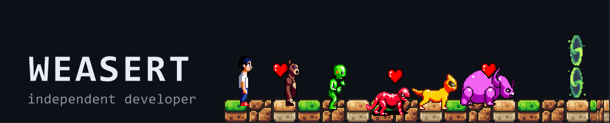

  

# Weasert

`Game Development / Software Development`

I build games, software, and tools.

## Game Development

Small, complete loops in **Godot** — gameplay systems, shaders, and one LAN-multiplayer experiment so far.

- **[Trilink](https://github.com/Weasert911/tri-link)** — two-player arena fighter. Matching colors let you hit, breaking them lets you phase. Ships a Windows build, a website, and automated tests.
- **[Monster's Shephard](https://github.com/Weasert911/GIC-GJ-Five-Monsters-Shephard)** — Godot India Community Game Jam 5 entry: trigger monster charges with the matching horn. Three tiers, one run.
- **[X](https://github.com/Weasert911/X)** — in development: a narrative stealth-FPS built design-first — full GDD suite, playable slice landing system by system.

Also: [Bound to Survive](https://github.com/Weasert911/Bound-to-Survive) — 90-second flashlight survival · [You Must Eat](https://github.com/Weasert911/You-Must-Eat) — CCTV anomaly demo.

## Software Development

Rust is the current direction: CLI tools first, systems fundamentals behind them. Python, HTML/CSS, SQL, Linux, and Git support the work.

- **[job-ready-roadmap](https://github.com/Weasert911/job-ready-roadmap)** — the working system: phases, weekly deliverables, and evidence rules for the Rust + TypeScript sprint.
- First CLI builds land here as separate repos when they run.

## Currently Exploring

- **Rust** — fundamentals → first CLI tools
- **Systems** — processes, memory, async
- **Tools** — utilities I actually need
- **Games** — the X slice; herding and survival loops

## Connect

- GitHub: [Weasert911](https://github.com/Weasert911)

Issues or discussions on any project reach me fastest.
